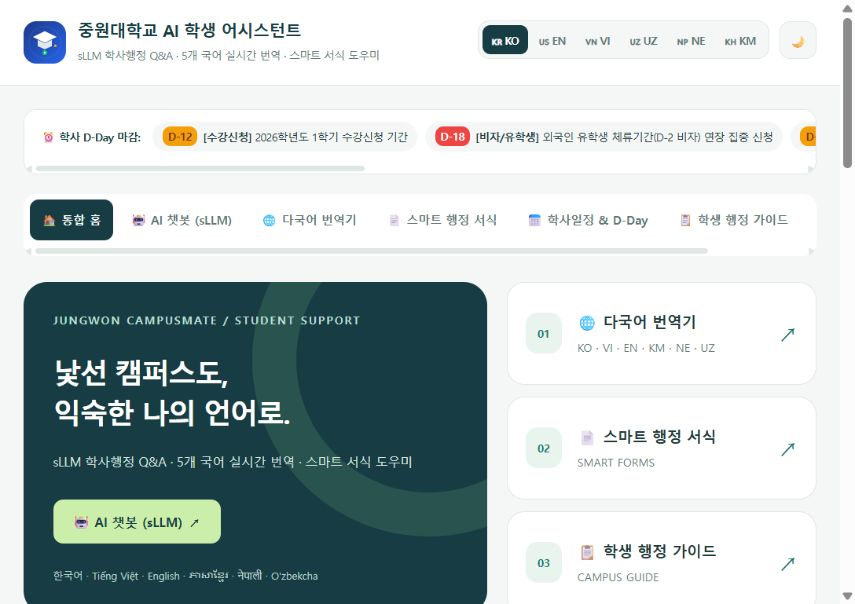

# Jungwon University AI Student Assistant — Step 10 (Full Enterprise Showcase)

## 최근 진행 상황 (2026-10-28)

- 한국어와 베트남어·영어·크메르어(캄보디아)·네팔어·우즈베크어 번역 선택 및 챗봇 번역 버튼 정비.
- 자동 언어 감지, 긴 UTF-8 입력 처리, 번역 API 오류 처리와 실패 후 재시도 개선.
- `data/sllm_info.json`과 `/api/sllm-info`에 실제 챗봇 구성 및 지식 자료 정보 제공.
- 홈 바로가기 카드, 챗봇·번역기·상세 안내 디자인 통일, 모바일 배치와 다크 모드 개선.
- 검증: 자동 테스트 12개 통과. 모바일 브라우저에서 ‘장학금 → 크메르어’ 사전 번역 동작 확인. 외부 번역 제공자는 자동 테스트에서 모의 응답으로 검증.
- 현재 챗봇은 JSON 키워드 검색과 템플릿 방식입니다. 실제 sLLM 모델 가중치/추론 서버 연결 및 외부 번역 서비스의 실환경 품질 검증은 후속 작업입니다.



---

중원대학교 재학생 및 5개국 외국인 유학생을 위한 **sLLM 지식 기반 학사·행정 Q&A, 5개 국어 실시간 번역, 음성(STT/TTS) 인식 및 스마트 행정 서식 자동 발급 통합 플랫폼**입니다.

---

## 🌟 주요 기능 총람

### 1. 🤖 sLLM 기반 학사·행정 Q&A 지식 엔진 (`sllm_engine.py`)
- **10대 학사·행정 완벽 지원**:
  1. **휴학** (Leave of Absence): 신청 기간, 지도교수 면담, 유학생 D-2 비자 출국 규정
  2. **복학** (Return to School): 수강신청 전 일정, 미복학 제적 방지, 표준입학허가서 재발급
  3. **증명서 발급** (Certificates): 인터넷 증명발급 포털(24시간), 학생회관 무인발급기
  4. **장학금** (Scholarships): 성적우수장학, 국가장학금, 외국인 TOPIK 3~6급 30%~100% 감면
  5. **졸업요건** (Graduation): 130학점(전공 60/교양 30), 캡스톤/논문, 외국인 TOPIK 4급 의무
  6. **생활관/기숙사** (Dormitory): 입사 신청, ★ 흉부 X-ray 결핵진단서 필수 지참, 23:30 통금
  7. **비자/체류관리** (Visa & Immigration): D-2 비자 연장, 하이코리아 예약, 시간제취업(알바) 허가
  8. **수강신청/학점** (Course Registration): 장바구니, 수강정정, 최소 12학점, 학사경고(GPA 1.5)
  9. **등록금 납부** (Tuition & Installment): 개인 가상계좌 입금, 최대 4회 분할납부 신청
  10. **캠퍼스 시설/식당** (Facilities): 도서관 열람실 좌석 예약, 학생식당 키오스크, 보건소 무료 약
- **이중 언어 원문(Bilingual Accordion)**: 외국어 답변 하단에 **`[학교 행정실·교직원 제출용 한국어 공식 원문]`** 접이식 토글 제공.

### 2. 🎙️ 음성 인식(STT) & 음성 읽기(TTS)
- **마이크 음성 입력 (STT)**: 챗봇 입력창 좌측의 🎙️ 버튼을 눌러 한국어, 영어, 베트남어 등으로 말하면 자동 텍스트 변환 및 전송.
- **음성 안내 (TTS)**: 챗봇 답변 및 번역문마다 🔊 버튼을 눌러 자연스러운 원어민 발음으로 청취.

### 3. 📄 스마트 행정 서식 자동 발급기 (`form_generator.py`)
- 학번, 이름, 사유 등 몇 가지 정보만 입력하면 대학 공식 양식 서식 자동 생성:
  - 📝 **휴학원서** (Application for Leave of Absence)
  - 📝 **복학원서** (Application for Return to School)
  - 📝 **외국인 유학생 시간제취업(알바) 확인서** (Part-time Work Permit)
  - 📝 **생활관(기숙사) 입사신청서** (Dormitory Application)
- **원클릭 인쇄 (🖨️ 바로 인쇄하기)** 및 **텍스트 파일 다운로드 (📥 .txt)** 기능 지원.

### 4. 📅 2026학년도 학사일정 & D-Day 알림 바 (`data/calendar.json`)
- 실시간 D-Day 마감 알림 티커:
  - 수강신청 기간 (D-12)
  - 외국인 D-2 비자 연장 집중 기간 (D-18)
  - 기숙사 결핵진단서 제출 마감 (D-22)
  - 등록금 정규 납부 마감 (D-25)

### 5. 🌐 한국어 + 5개 외국어 양방향 번역기
- 🇰🇷 **Korean (한국어)**
- 🇺🇸 **English (영어)**
- 🇻🇳 **Vietnam (Tiếng Việt)**
- 🇺🇿 **Uzbek (O'zbekcha)**
- 🇳🇵 **Nepal (नेपाली)**
- 🇰🇭 **Khmer (ភាសាខ្មែរ, 캄보디아어/크메르어)**

번역기와 챗봇 답변의 번역 버튼에서 위 6개 언어를 선택할 수 있습니다.
원본 언어 자동 감지는 Google 번역에 `auto`로 전달하며, MyMemory는 원본 언어를 직접 선택했을 때 대체 번역을 제공합니다.
일반 문장은 외부 번역 서비스로 전송되므로 인터넷 연결이 필요합니다. 서비스 제한이나 장애 시 번역기는 오류를 표시하고, 챗봇 상담은 한국어 원문을 제공합니다. 학사 용어 사전은 오프라인에서도 사용할 수 있습니다.

### SLLM 챗봇 정보 파일

- `data/sllm_info.json`: 챗봇 소개, 실제 엔진 방식, 지식 파일 경로, 지원 언어, 번역 제공자와 관리 방법.
- 챗봇 탭 위쪽의 **SLLM · Info**를 펼치거나 `GET /api/sllm-info`로 확인할 수 있습니다.
- 현재 엔진은 `procedures.json`과 `notices.json`을 키워드로 검색하고 템플릿으로 답변을 구성합니다. 신경망 sLLM 가중치나 추론 서버는 아직 연결되어 있지 않습니다.
- 안내 내용을 추가하려면 기존 JSON 구조에 맞춰 `data/procedures.json` 또는 `data/notices.json`을 수정하세요.

번역 API 예시 (`POST /api/translate`, `Content-Type: application/json`):

```json
{"text": "장학금", "source_lang": "ko", "target_lang": "km"}
```

`target_lang`은 `vi`, `en`, `km`, `ne`, `uz`, `ko`를 지원하고 `source_lang`은 추가로 `auto`를 지원합니다. 잘못된 입력은 HTTP 400, 번역 서비스 장애는 HTTP 503을 반환합니다. 요청당 최대 10,000자이며 실패한 번역은 캐시에 저장하지 않습니다.

검증: `python -m unittest discover -s tests -v` (외부 번역 서비스는 모의 응답으로 검증).

### 6. 🌙 다크 모드 (Dark / Light Theme) & 대화 저장
- 눈이 편안한 다크 모드 테마 스위치 (localStorage 영구 저장).
- 챗봇 상담 내용을 언제든 내려받을 수 있는 **📥 대화 저장** 기능.

---

## 🚀 빠른 시작

```bash
# 가상환경 활성화 및 실행
venv\Scripts\activate.bat
python app.py
```
* 웹 서비스 접속: [http://127.0.0.1:5008](http://127.0.0.1:5008)
